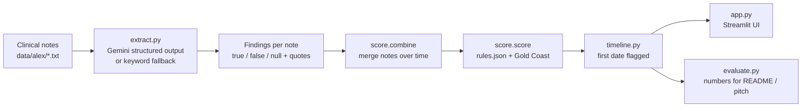

# PRD: ALS RedFlag

## Problem

Alex Chen, 47, a high-school biology teacher, first noticed his whiteboard handwriting fading in **June 2024**. He was diagnosed with ALS on **14 July 2026**, about 25 months later. In between:

| Date | Who | What they saw | What happened |
|---|---|---|---|
| 14 Oct 2024 | Family doctor | Right hand weakness, flatter right thenar eminence, no pain, no numbness, night cramps | Referred for carpal tunnel |
| 9 Dec 2024 | Hand surgeon | Normal wrist nerve conduction, visible thenar and first dorsal interosseous wasting, grip 4/5 | Carpal tunnel release (20 Jan 2025) as "a trial" |
| 21 Apr 2025 | Hand surgeon | No improvement, weaker, forearm twitching ("rippling"), right foot catching on stairs | Back to GP; neurology "may be helpful if symptoms progress" |
| Aug 2025 – Feb 2026 | Physiotherapist | Foot drop worsening 4/5 → 3/5, calf/thigh wasting, **brisk reflexes incl. right ankle** | Lumbar MRI normal; PT recommends neurology |
| 16 Feb 2026 | Family doctor | Twitching in both forearms and thigh, 6 kg weight loss, brisk reflexes in all four limbs | Urgent neurology referral |
| 11 Jun 2026 | Neurologist | Upper + lower motor neuron signs in 4 regions; EMG confirms (18 Jun) | Diagnosis 14 Jul 2026 |

Each clinician saw part of the pattern; nobody put it together. Canadian ALS diagnosis typically takes 15–27 months. Riluzole and edaravone add months; earlier diagnosis means earlier multidisciplinary care, nutrition and breathing support, and trial eligibility.

## Solution in one sentence

A decision-support tool that reads a patient's clinical notes in order, pulls out ALS red-flag findings with quoted evidence, and tells the clinician when the pattern warrants an urgent neurology referral and EMG.

## Demo path

See `docs/DEMO.md`. Summary:

1. Load Alex's notes (typed from the case file) into the app.
2. Step through the timeline; each note adds findings, with quotes.
3. Show the first note that crosses the "urgent referral" threshold, and how many months before the actual diagnosis that was.
4. Show the evidence and the recommended action (urgent neurology, EMG, consider serum NfL).
5. Show a carpal-tunnel mimic note scoring low (the tool does not flag everyone).

## Must have

- [x] Findings extraction (Gemini structured output + offline keyword fallback): `extract.py`
- [x] Rule scoring + Gold Coast pattern, editable weights: `score.py`, `rules.json`
- [x] Timeline / first-flag: `timeline.py`
- [ ] Alex's notes in `data/alex/` (typed from the case file, pages 7–9)
- [ ] Streamlit UI: `app.py`
- [ ] Evaluation script with honest numbers: `evaluate.py` (Alex timeline + mimic cases)
- [ ] README numbers that match a reproducible run

## Nice to have

- Side-by-side comparison with ReferALS (ALS Canada's referral checklist): what the tool adds
- Upload/paste a new note in the UI
- Mimic set: carpal tunnel, cervical radiculopathy, peripheral neuropathy notes that should score low
- Exportable referral letter draft for the GP

## Out of scope

- Diagnosing ALS (the tool recommends referral; neurologists diagnose)
- Biofluid test strip (no lab, no antibodies, regulatory class IVD)
- Real patient data or EHR integration
- Home consumer screening (very low base rate → mostly false alarms)

## Judging criteria / sponsor tracks

Track rubric (Detection and Diagnostics, /100):

| Criterion | Points | How we hit Level 4 |
|---|---|---|
| Clinical grounding | 20 | Every finding and rule traces to Alex's notes or the Gold Coast criteria |
| Diagnostic value | 30 | Clear "what it detects" (referral-worthy ALS pattern) and advantage over current practice and ReferALS |
| Evidence and testing | 20 | Reproducible timeline run, mimic cases, stated limits (n=1 case, invented test notes) and a plan for real validation |
| Feasibility | 15 | Fits GP workflow, cost per note, privacy, Health Canada decision-support framing |
| Communication | 15 | 60-second pitch, demo works offline, questions answered with numbers |

Judges also rank their top 3 per track; two teams win per track.

Sponsor prizes (optional, opt in on Devpost): **Best Use of Gemini API** (we use it). Others: ElevenLabs, Solana, Tiger Data, Vultr, Entire, GoDaddy Registry, Bambu Lab.

## Architecture

## External APIs and docs

| API / library | Used for | Docs |
|---|---|---|
| Google Gemini (`google-genai`) | Structured findings extraction | https://ai.google.dev/gemini-api/docs |
| Streamlit | UI | https://docs.streamlit.io |
| Pydantic v2 | Findings schema / response schema | https://docs.pydantic.dev |
| Gold Coast criteria | Scoring rule | Shefner et al., Clin Neurophysiol 2020;131(8):1975–1978 |
| ReferALS (ALS Canada) | Baseline to compare against | als.ca/resource/referals-early-referral-tool |
